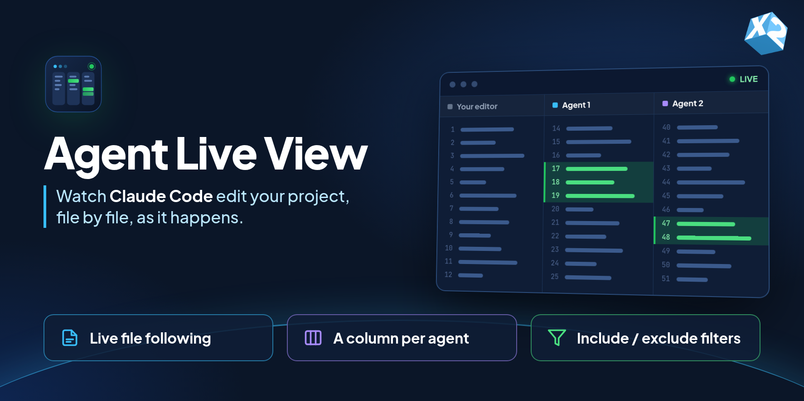

<p align="center"></p>

# Agent Live View

See what your AI coding agent is changing while it works. When Claude Code (or any other tool) edits a file in your workspace, Agent Live View opens that file in a separate editor column, scrolls to the change and briefly highlights the edited lines in green.

Your own editor stays where it is. Agent files open in the columns to its right, and your cursor and scroll position are never moved.

> **Preview release.** Agent Live View is under active development. Please report problems on [GitHub](https://github.com/craftyfm/x2-agent-live-view/issues).

## Features

- **Live file following.** Changed files open as normal editor tabs with syntax highlighting, not as tool-call logs. Works with edits made through the editor, shell commands, scripts and build tools.
- **Changed lines highlighted.** The editor scrolls to the change and highlights it for a few seconds (configurable).
- **Viewing pace.** Each file stays in front for at least 4 seconds before the next one replaces it, so you have time to read it. Claude Code is never slowed down; repeated writes to the same file are combined.
- **A column per agent.** With the optional Claude Code hooks installed, each agent and subagent gets its own column (up to three), and tabs from the previous prompt are closed when the next prompt starts editing.
- **Include and exclude filters.** Only source files are shown by default. Logs, build output, caches, scratch files and most JSON are skipped. Exclusions always win over inclusions.

## Getting started

1. Install the extension and open a project folder.
2. Check that the status bar shows **Live View: ON**. Click it to pause or resume.
3. Ask Claude Code to change some source files. Each changed file opens in the column to the right of your editor.

That is all you need for basic use. To get a column per agent and automatic tab clean-up, install the Claude Code hooks below.

## Claude Code hooks (optional)

Without hooks, Agent Live View sees *that* a file changed but not *which agent* changed it, so all changes share one column.

Run **Agent Live View: Install Claude Agent Tracking Hooks** from the Command Palette, then start a new Claude Code session. This:

- adds hook entries to the project's `.claude/settings.local.json` (a local file that is normally not committed), and backs up the original to `.claude/settings.local.json.agent-live-view.bak` the first time;
- copies a small hook script to `~/.agent-live-view/`, so the hooks keep working when the extension updates.

**Privacy.** The hook script records only the event name, session and agent IDs, tool name and file path. It does not record prompts, commands, file contents or tool output, and it makes no network requests. Events are written to `~/.agent-live-view/events/`, which only your user account can read.

To remove the hooks, run **Agent Live View: Remove Claude Agent Tracking Hooks**. Uninstalling the extension also removes them from every project where they were installed.

Hooks need [Node.js](https://nodejs.org/) to be installed.

## Choosing which files appear

By default (`agentLiveView.filterMode: "includeOnly"`) only files matching `agentLiveView.includeFiles` appear. This covers common source types: `ts`, `tsx`, `js`, `jsx`, `php`, `twig`, `vue`, `svelte`, `css`, `scss`, `sass`, `less`, `html`, `py`, `sql`, `go` and `rs`.

JSON is not included by default. Add only the files you care about:

```json
"agentLiveView.includeFiles": [
  "**/*.{ts,tsx,js,jsx}",
  "**/*.php",
  "**/package.json",
  "config/important.json"
]
```

`agentLiveView.excludeFiles` lists patterns that never appear, even if they match an include pattern. The defaults cover logs, traces, temporary and backup files, and `scratch`, `tmp`, `temp`, `logs` and `traces` folders. `agentLiveView.excludeFolders` lists folder names that are skipped wherever they occur, such as `node_modules`, `vendor`, `dist` and `.git`.

Patterns are relative to the workspace folder and support `*`, `**`, `?` and `{a,b}`. A pattern without a `/` (such as `*.log`) matches file names in any folder. Supplying your own list replaces the default list.

To edit the lists without opening settings, use **Manage Included Patterns** and **Manage Excluded Patterns**. Changes apply immediately.

Set `agentLiveView.filterMode` to `"excludeOnly"` to show every file except exclusions.

## Settings

| Setting | Default | Description |
| --- | --- | --- |
| `agentLiveView.enabled` | `true` | Open changed files automatically. |
| `agentLiveView.reserveFirstColumn` | `true` | Keep the first editor column for your own work. Agent files open to its right. |
| `agentLiveView.maxColumns` | `3` | Maximum number of editor columns used for agents. |
| `agentLiveView.minViewMs` | `4000` | Minimum time a file stays in front before another file replaces it in the same column. |
| `agentLiveView.highlightDurationMs` | `6000` | How long edited lines stay highlighted. `0` turns highlighting off. |
| `agentLiveView.debounceMs` | `180` | Wait after a change before opening the file. |
| `agentLiveView.maxFileSizeKb` | `1536` | Larger files are not opened. |
| `agentLiveView.filterMode` | `includeOnly` | `includeOnly` or `excludeOnly`. |
| `agentLiveView.includeFiles` | source types | Files that may appear in `includeOnly` mode. |
| `agentLiveView.excludeFiles` | noise patterns | Files that never appear. |
| `agentLiveView.excludeFolders` | build/cache folders | Folder names that are always skipped. |
| `agentLiveView.ignoreUnattributedWhenHooksActive` | `false` | With hooks installed, skip changes that cannot be linked to a Claude Code agent. |

## Commands

- **Agent Live View: Toggle Watching**
- **Agent Live View: Set Viewing Pace**
- **Agent Live View: Manage Included Patterns**
- **Agent Live View: Manage Excluded Patterns**
- **Agent Live View: Install Claude Agent Tracking Hooks**
- **Agent Live View: Remove Claude Agent Tracking Hooks**
- **Agent Live View: Close Automatically Opened Tabs**
- **Agent Live View: Show Diagnostics**: writes the current state to **View > Output > Agent Live View**.

## Known limitations

- Without hooks, changes made by other programs (formatters, `git checkout`, build tools) also appear. Your own saves in files you have just typed in are ignored. At most 25 files wait to be shown; when more change at once, the oldest are skipped.
- The first edit to a file that is not tracked by git may scroll to the end of the file instead of to the change. Later edits are located exactly.
- Keep the Claude Code chat in the sidebar rather than in an editor column, so agent files do not cover it.
- Changes in a git worktree outside the open workspace are not seen. Add the worktree as a workspace folder to follow it.
- Agent Live View closes only tabs that it opened, and never closes pinned or unsaved tabs.
- In untrusted workspaces, git is not used to find changed lines, hooks cannot be installed and the workspace's own pattern settings are ignored.
- Remote and virtual workspaces have not been tested.

## Development

Requires Node.js 18 or later. There are no runtime dependencies.

```bash
npm test          # unit tests
npm run check     # syntax check
npm run package   # build a .vsix with @vscode/vsce
```

Press F5 in VS Code to start an Extension Development Host with the extension loaded.

## License

[MIT](LICENSE) © X2 Network Pty Ltd
